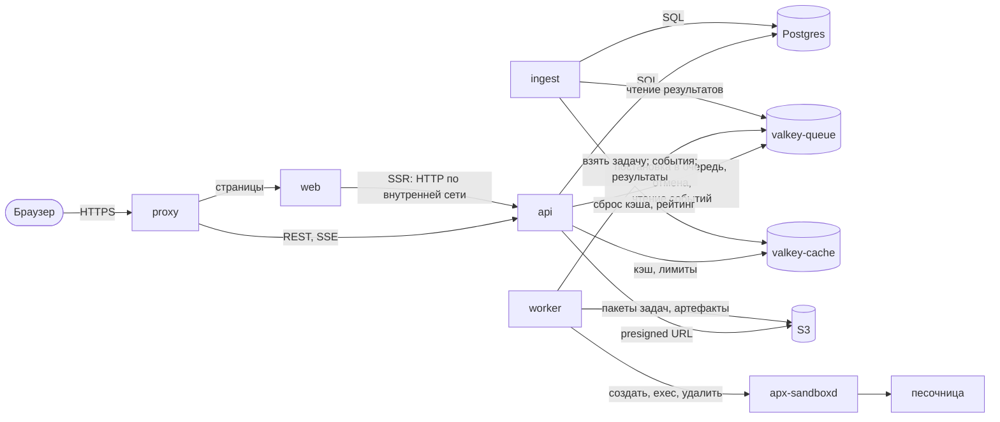

# Архитектура

> Код ещё не написан: документ описывает целевую архитектуру из [спецификации](../specs/03-architecture.md). Его обновляет каждый PR, который меняет состав компонентов, их связи или потоки данных; после реализации здесь описывается то, что есть в коде.

Apparatica — модульный монолит на бэкенде, отдельные воркеры проверки и Next.js-фронтенд. Все компоненты открытые и самохостируемые; стенд поднимается `docker compose up`.

## Компоненты

| Компонент | Что делает | Технологии |
|---|---|---|
| `proxy` | Единая точка входа: TLS, HTTP/2, `/api/*` → `api`, остальное → `web`. Сайт и API на одном домене, поэтому не нужен CORS, а cookie сессии общая | Caddy |
| `web` | Интерфейс. Публичные страницы рендерит на сервере (SSR), страница задачи с редактором работает в браузере. Генерирует OG-картинки. Просмотрщик волн Surfer открывается в изолированном iframe с отдельного origin | Next.js, React, TypeScript |
| `api` | HTTP API: задачи, отправки, пользователи, рейтинги; поток событий проверки (SSE); вход; админка `/admin` | FastAPI, SQLAlchemy, SQLAdmin |
| `ingest` | Фоновый процесс бэкенда (см. ниже) | тот же Python-пакет, что `api` |
| `worker` | Берёт проверки из очереди и выполняет пайплайн в песочнице (через `apx-sandboxd`); стримит вывод; загружает артефакты | Python, Dramatiq, пакет `judge` |
| песочница | Одноразовый контейнер на одну проверку: Verilator, Yosys, SBY. Без сети и секретов. Все этапы в ней считаются недоверенными | Docker + gVisor, образ тулчейна |
| `postgres` | Источник правды: задачи, отправки, результаты, пользователи, рейтинги | PostgreSQL |
| `valkey-queue` | Очередь проверок, потоки событий и результатов, ключи отмены, аренды и попыток. Не теряет данные (AOF, без вытеснения) | Valkey (Redis-совместимый) |
| `valkey-cache` | Кэш ответов, rate limit, общий рейтинг. Может потерять данные без последствий | Valkey |
| `garage` | Файлы в отдельных бакетах: пакеты задач, артефакты (логи, FST, нетлисты), кэш сборок, статика просмотрщика волн | Garage (S3 API) |
| `apx-sandboxd` | На хосте воркера: создаёт и уничтожает контейнеры песочницы с фиксированными флагами. Единственный процесс с доступом к Docker | небольшой самописный сервис |

### `ingest`

Воркеры намеренно не имеют доступа к базе данных (они исполняют чужой код, и чем меньше у них прав, тем лучше). Поэтому результаты проверок они пишут в Redis, а в базу их переносит `ingest`:

1. читает поток `judge:results` (результаты этапов и итог проверки), проверяет токен задания, выданный API;
2. сохраняет результаты этапов в Postgres и считает итоговый вердикт — только он, воркер вердикт не считает; повторная доставка того же результата ничего не ломает;
3. выполняет последствия принятой проверки: статус «решено» у пользователя, место в рейтинге задачи, общий рейтинг, сброс кэша страниц — и публикует для браузера событие `finalized` с итогом и местом;
4. страхует от зависших проверок: если проверка давно в работе, а воркер её не держит, ставит «Внутренняя ошибка» (перезапуск после гибели воркера делает сама очередь);
5. выполняет периодические задачи: удаление старых гостевых отправок, пересчёт процента принятых, снимки рейтинга для «+N за неделю». При нескольких экземплярах `ingest` этим занимается один — лидер.

Это тот же код, что и `api` (общие модели и сервисы), запущенный другой командой (`apparatica ingest`). Отдельный процесс нужен, чтобы фоновая работа не мешала обработке HTTP-запросов и масштабировалась отдельно.

### Очередь проверок

`api` передаёт проверку воркерам через Dramatiq на `valkey-queue` (ADR-0002). Общий у них только модуль `judge.core.jobs`: имя актора `judge_submission`, имена очередей и модель задания `JudgeJob`. Воркер не ходит в базу, поэтому в задании есть всё нужное для прогона: код, сид, вид проверки, ключ и хэш пакета задачи, профиль и образ тулчейна с digest, токен задания. `api` ставит сообщение через брокер Dramatiq, не импортируя код воркера.

- **Очереди.** `judge.light` и `judge.heavy` выбираются по `resource_class` версии задачи. Перепроверки (Ф5) идут в `judge.rejudge`.
- **Слоты.** Процесс `apparatica-worker` держит два пула потоков Dramatiq на одном брокере. Основные слоты (`APX_SLOTS`) обслуживают `APX_QUEUES`. Отдельные слоты (`APX_REJUDGE_SLOTS`, по умолчанию 1) обслуживают `judge.rejudge`, поэтому массовая перепроверка не занимает слоты живых пользователей. Воркер берёт из очереди не больше сообщений, чем у него свободных слотов: проверка долгая, и остальные сообщения ждут любого свободного воркера.
- **Без повторов.** У актора `max_retries=0` и нет `TimeLimit`. Сообщение умершего воркера заново ставит только сам брокер. Битое сообщение (задание не прошло проверку схемы) не повторяется.
- **Позиция в очереди.** Sorted set `queue:<очередь>`: `api` добавляет отправку при постановке, воркер убирает её, когда берёт задание. Позиция в `GET /submissions/{id}` — это ранг в этом наборе.
- **Очередь недоступна.** Отправка уже сохранена, но в очередь не попала: `api` отвечает `503 JUDGE_UNAVAILABLE` и помечает её `internal_error` с кодом `QUEUE_UNAVAILABLE`, иначе она ждала бы вечно.

Сейчас воркер только берёт задание и снимает его с позиции; запуск проверки в песочнице появится вместе с оркестратором (T1.2b), а воркер на стенде — в T1.21.

### Песочница: `apx-sandboxd`

Оркестратор разбирает недоверенный вывод, поэтому доступа к Docker у него нет (ADR-0003, specs/07 §5.3). Контейнерами песочницы управляет `apx-sandboxd` — демон на хосте воркера (`apparatica_worker.sandboxd`). Оркестратор обращается к нему через unix-сокет: одно JSON-сообщение на соединение, ответы — JSON-строки.

| Операция | Что делает |
|---|---|
| `info` | рантайм и разрешённые образы: воркер проверяет, что на staging и в production это `runsc` |
| `create` | контейнер из разрешённого образа с лимитами не выше потолков демона; в ответ — непрозрачный ID |
| `exec` | команда в контейнере: с TTY (команды этапов, вывод потоком) или со stdin (tar-поток входных файлов), но не одновременно; `cwd` — только внутри `/work` |
| `kill` | `kill -KILL -1` от пользователя песочницы: все процессы этапа, кроме PID 1 |
| `destroy` | удаление контейнера |

Что решает демон, а не клиент:

- **Флаги контейнера** — `judge.core.executor.sandbox_flags`, те же, что у `judge run`: без сети, корневая ФС только для чтения, `/work` и `/tmp` — tmpfs, пользователь песочницы, `--cap-drop=ALL`, `no-new-privileges`, лимиты памяти, CPU и процессов. PID 1 — `apx-init`.
- **Рантайм** (`runsc`, для разработки без gVisor — `runc`), **разрешённые образы** (по имени репозитория) и **потолки ресурсов** задаются настройками демона ([configuration.md](configuration.md#apx-sandboxd)).
- **Имена контейнеров.** Клиент получает непрозрачный ID и может ссылаться только на контейнеры, созданные этим демоном. Аргументы `exec` идут после имени контейнера и не могут стать флагами Docker.
- **Уборка.** Контейнеры помечены меткой `apparatica.sandbox`. При старте демон удаляет оставшиеся от прошлого запуска. Контейнер старше `APX_SANDBOXD_MAX_LIFETIME_S` удаляется: его оркестратор умер, не вызвав `destroy`.

Если клиент отключился посреди `exec`, демон перестаёт следить за командой. Процессы, которые она запустила в контейнере, умирают при следующем `kill` или `destroy`, а не вместе с клиентом `docker exec` (S6).

На стороне воркера `SandboxExecutor` — тот же `ContainerExecutor`, что у `judge run`, только контейнер создаётся через демон. Подключение воркера к демону и выбор исполнителя появятся вместе с оркестратором (T1.2b), установка демона на хост воркера — в T1.23.

### SSR

SSR (server-side rendering) — страница собирается на сервере Next.js: сервер сам запрашивает данные у `api` по внутренней сети Docker, рендерит HTML и отдаёт его браузеру готовым. Так рендерятся каталог, условие задачи, решения, рейтинги и профили: их видят поисковики и превью ссылок в мессенджерах, а пользователь быстрее получает первую отрисовку. «SSR-запросы» — эти запросы от `web` к `api`. Если запрос делается от имени пользователя, `web` передаёт его cookie сессии. `web` не обращается к базе данных напрямую — только через API.

## Как компоненты общаются

| Откуда → куда | Канал | Что передаётся |
|---|---|---|
| Браузер → `web` | HTTPS | страницы |
| Браузер → `api` | HTTPS, JSON; SSE | действия пользователя; поток событий проверки |
| `web` → `api` | HTTP по внутренней сети | данные для SSR |
| Модуль бэкенда → модуль бэкенда | вызов функции сервиса в том же процессе | например, `submissions` спрашивает у `problems` версию задачи |
| `api` → `worker` | очередь Dramatiq в `valkey-queue` | задание на проверку (ID отправки, код, ссылка на пакет задачи) |
| `api` → `worker` (отмена) | ключ и канал в `valkey-queue` | «остановить проверку N» |
| `worker` → браузер | поток `sub:<id>` в `valkey-queue` → `api` → SSE | вывод инструментов, начало и конец этапов, прогресс тестов |
| `worker` → `ingest` | поток `judge:results` в `valkey-queue` | результаты этапов с токеном задания |
| `ingest` → браузер | событие `finalized` в поток `sub:<id>` → `api` → SSE | итоговый вердикт и место в рейтинге |
| `worker` ↔ песочница | через `apx-sandboxd` (unix-socket): создание контейнера, `exec` с PTY или со stdin, уничтожение процессов, удаление ([подробнее](#песочница-apx-sandboxd)) | команды этапов, вывод, файлы результатов |
| `worker`, `api` ↔ файлы | S3 | пакеты задач, логи, FST, нетлисты; браузер скачивает по временной ссылке |
| `api`, `ingest` ↔ данные | Postgres (общий), `valkey-cache` | — |

Правила:

- **Внутри бэкенда нет сетевых вызовов между модулями.** Модули (`problems`, `submissions`, `judging`, `leaderboards`, `users`, `auth`, `moderation`) — Python-пакеты одного приложения. Они вызывают публичные функции сервисов друг друга и не читают чужие таблицы напрямую. Граница проверяется в CI (import-linter). Общей шины событий внутри монолита на старте нет: последствия проверки `ingest` выполняет явными вызовами сервисов `leaderboards` и `users`.
- **`api` и `worker` никогда не вызывают друг друга напрямую** — только через Redis. Благодаря этому воркеры можно добавлять и убирать без изменений в API, а API продолжает работать, пока воркеры недоступны.
- **В базу пишут только `api` и `ingest`.** У воркеров есть доступ только к Valkey (по ACL) и к своим бакетам хранилища; результаты принимаются только с токеном задания.
- **Docker доступен только `apx-sandboxd`.** Оркестратор воркера разбирает недоверенный вывод, поэтому сам Docker не получает.
- **Песочница не имеет сети.** Всё общение с ней — через оркестратор воркера.

## Путь одной проверки

1. Браузер отправляет код: `POST /api/v1/submissions`. `api` сохраняет отправку (статус «В очереди») и ставит задание в очередь.
2. Браузер подписывается на `GET /api/v1/submissions/{id}/events` (SSE).
3. `worker` берёт задание, создаёт песочницу и по очереди выполняет этапы: статическая проверка → линт → симуляция → синтез → симуляция нетлиста → формал. Вывод и события он пишет в поток `sub:<id>`; `api` пересылает их в браузер.
4. По каждому завершённому этапу `worker` пишет результат в `judge:results`; `ingest` сохраняет его в Postgres. Между этапами `worker` убивает все процессы в песочнице.
5. По окончании `worker` загружает логи и FST в хранилище и удаляет песочницу; `ingest` считает вердикт, обновляет рейтинги и отправляет в браузер событие `finalized` — по нему показывается итоговый баннер.

Подробности: [пайплайн проверки](../specs/07-judge-pipeline.md), решения — [ADR-0002](adr/0002-task-queue-dramatiq.md), [ADR-0008](adr/0008-log-streaming.md), [ADR-0009](adr/0009-results-ingestion.md).
