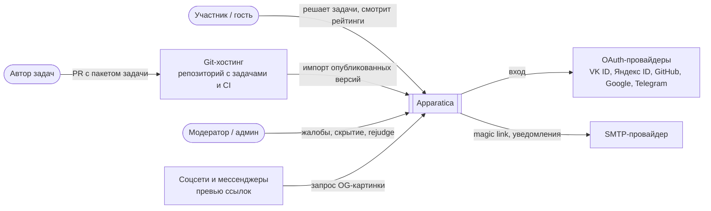
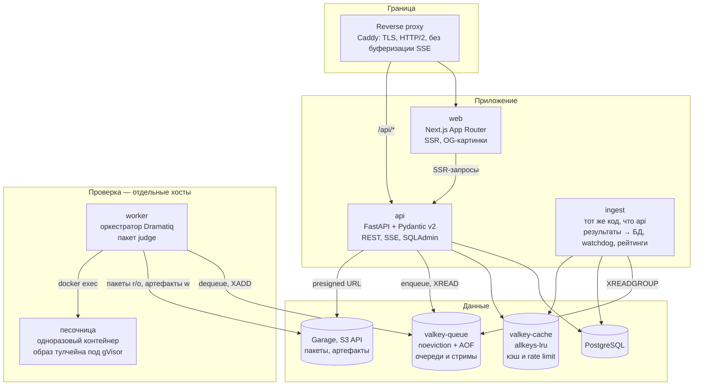

# 03. Архитектура

Модульный монолит на бэкенде, отдельные воркеры проверки, Next.js-фронтенд. Все компоненты открытые и самохостируемые; полный стенд поднимается `docker compose up`.

## 1. C4 — контекст



Все внешние системы опциональны и отключаются в конфиге: инстанс без OAuth работает со входом по email, без SMTP — только гостевой режим.

## 2. C4 — контейнеры



| Контейнер | Технологии | Ответственность |
|---|---|---|
| `proxy` | Caddy 2 | TLS, HTTP/2, маршрутизация `/api` → api, остальное → web; заголовки безопасности |
| `web` | Next.js 16 (App Router), React 19, TS, Tailwind 4, shadcn/ui, TanStack Query, Monaco, Surfer (статический WASM на отдельном origin) | интерфейс, SSR публичных страниц, OG-картинки (`next/og`) |
| `api` | FastAPI, SQLAlchemy 2.0 async, Alembic, Authlib, SQLAdmin | REST API, SSE, аутентификация, админка `/admin` |
| `ingest` | тот же Python-пакет, команда `apparatica ingest` | фоновый процесс: переносит результаты проверок из Redis в Postgres (воркеры доступа к БД не имеют), агрегирует вердикт, обновляет статусы и рейтинги, перезапускает зависшие проверки, чистит старые данные |
| `worker` | Python, Dramatiq, пакет `judge` | исполнение пайплайна в песочнице, стриминг событий, загрузка артефактов |
| `toolchain` (образ) | Verilator 5.x, Yosys + yosys-slang, SBY + решатели, OpenSTA, Verible, pyslang, liberty, `apx_tb_pkg` | всё, что исполняется в песочнице; образ = `ToolchainProfile` |
| `postgres` | PostgreSQL 17 | источник правды |
| `valkey-queue` | Valkey 8 | очереди Dramatiq, стримы событий и результатов, ключи отмены и heartbeat |
| `valkey-cache` | Valkey 8 | кэш ответов, rate limit, sorted sets общего рейтинга |
| `garage` | Garage (S3 API) | бакеты `packages`, `artifacts`, `build-cache`, `waveview` (статика Surfer на отдельном origin) |
| `apx-sandboxd` | небольшой процесс на хосте воркера | создание, запуск и уничтожение контейнеров песочницы с фиксированными флагами; единственный, у кого есть docker socket |

Web и API доступны с одного origin (через proxy) — CORS не нужен, cookie сессии общая. SSR-запросы — запросы сервера Next.js к API по внутренней сети при рендеринге страницы на сервере.

Каналы взаимодействия компонентов и правила (без сетевых вызовов внутри монолита, `api` и `worker` общаются только через Redis, в БД пишут только `api` и `ingest`) — в [docs/architecture.md](../docs/architecture.md#как-компоненты-общаются).

## 3. C4 — компоненты бэкенда

Модульный монолит: каждый модуль — пакет с `api.py` (роутеры), `service.py`, `models.py` (SQLAlchemy), `schemas.py` (Pydantic). Модули общаются через сервисы, а не через чужие таблицы. Правило проверяется `import-linter` в CI.

```
backend/src/apparatica/
  core/          конфиг, БД, ошибки (problem+json), feature flags, i18n-коды, rate limit
  problems/      задачи, версии, теги, импорт пакетов, условия, эталоны
  submissions/   создание, постановка в очередь, статус, SSE, отмена, артефакты
  judging/       ингестор результатов, агрегирование вердикта, watchdog, rejudge
  leaderboards/  рейтинг решений задачи, общий рейтинг пользователей
  users/         пользователи, профили, дашборд, черновики, гостевой импорт
  auth/          OAuth/OIDC, Telegram, magic link, сессии, CSRF
  moderation/    жалобы, скрытие, журнал действий
  admin/         SQLAdmin-представления и действия
```

Зависимости модулей: `submissions → problems`, `judging → submissions, leaderboards, users`, `leaderboards → problems, users`, `moderation → problems, submissions, users`. Модуль `core` ни от кого не зависит.

## 4. C4 — компоненты судьи

```
judge/src/judge/
  core/
    pipeline.py      исполнение списка этапов, ранняя остановка, отмена
    verdict.py       агрегирование вердикта (вызывают CLI и ингестор)
    stage.py         протокол Stage, StageContext, StagePlan, StageOutcome
    executor.py      Executor: LocalDocker, Sandbox (gVisor), Host
    events.py        EventSink: консоль, файл JSONL, Redis Stream
    jobs.py          задание проверки в очереди: контракт API и воркера
    package.py       загрузка и валидация problem.yaml (Pydantic, сверка с JSON Schema)
    limits.py        лимиты песочницы и этапов: классы ресурсов (config/resource-classes.yaml) и переопределения задачи
    registry.py      языковые модули по ключу language
  languages/
    systemverilog/
      precheck.py    pyslang: интерфейс, запрещённые конструкции
      normalize.py   нормализованный AST-хэш
      stages/        lint.py, sim.py, synth.py, formal.py
      tbproto.py     разбор протокола apx (файл и строки прогресса)
      diagnostics.py разбор сообщений Verilator, Yosys, slang в file:line:col
  cli.py             judge validate | run | metrics | pack | new
worker/src/apparatica_worker/
  broker.py          брокер Dramatiq и акторы judge_submission, judge_waveform
  main.py            apparatica-worker: пулы слотов основных очередей и judge.rejudge
  orchestrator.py    попытка проверки: позиция, аренда, попытки, пакет, песочница, пайплайн, артефакты
  lease.py           аренда lease:<id> с продлением
  storage.py         кэш пакетов задач, загрузка артефактов
  report.py          отчёт о попытке, запись консоли этапов
  sandboxd/          apx-sandboxd (демон на хосте) и клиент SandboxExecutor
```

Граница «ядро ↔ язык»: ядро знает только `language`, `stage.type`, `failure_kind` и схемы метрик. Подсветка SV в редакторе — Monaco-язык `systemverilog`, выбирается по `language` задачи.

## 5. Компоненты фронтенда

```
web/src/
  app/                     маршруты App Router (см. 08-screens.md)
  components/ui/           shadcn/ui, перекрашенные токенами
  components/domain/       VerdictBadge, PipelineStage, DifficultyBadge, TagChip, MetricCard,
                           Console, TestList, WaveformPanel, LeaderboardRow, Heatmap, CodeViewer
  features/bench/          раскладка страницы задачи, редактор, панель результатов
  features/submission/     useSubmission (TanStack Query + SSE), машина состояний проверки
  features/guest/          локальные черновики и история, импорт
  lib/api/                 сгенерированный клиент (openapi-typescript + openapi-fetch)
  lib/statement/           Markdown → React: remark-gfm, remark-math, rehype-katex, WaveDrom, sanitize
  messages/ru.json         строки интерфейса (next-intl)
  styles/tokens.css        из handoff
```

- Публичные страницы (каталог, условие, решение, рейтинги, профиль) — серверные компоненты с кэшем `revalidate`; данные пользователя (статус «решено», своя строка) догружаются на клиенте.
- Страница задачи — клиентская часть с Monaco (динамический импорт, без SSR) и SSE.
- Surfer — статическая сборка со своими темами в бакете `waveview` на отдельном origin, изолированный iframe и адаптер `postMessage` (ADR-0004).

## 6. Структура монорепо

```
apparatica/
  AGENTS.md  CLAUDE.md  CONTRIBUTING.md  LICENSE  README.md
  docs/                 проектная документация: архитектура, глоссарий, ADR, руководства
  specs/                спецификация и план разработки
  backend/              FastAPI-приложение и ингестор (Poetry)
  judge/                пакет судьи и CLI (Poetry)
  worker/               оркестратор (Poetry), зависит от judge; worker/sandboxd/ — помощник apx-sandboxd
  web/                  Next.js (pnpm)
  toolchain/            Dockerfile образа тулчейна, apx_tb_pkg.sv, тесты образа
  problems/             пакеты задач, tags.yaml
  config/               difficulties.yaml, limits.yaml, resource-classes.yaml, providers.example.yaml
  scripts/              служебные скрипты репозитория (сверка lock-файлов и т. п.)
  deploy/               compose.yaml, compose.dev.yaml, Caddyfile, .env.example
  tests/e2e/            Playwright
  tests/security/       вредоносные решения и ожидаемые вердикты
  .github/workflows/    CI
```

Python — Poetry: у `backend`, `judge`, `worker` свои `pyproject.toml` и `poetry.lock`, `judge` подключается как path-зависимость (ADR-0001). JS — pnpm workspace (`web`, позже генерация клиента как пакет). Корневой `justfile` с командами `up`, `test`, `lint`, `openapi`, `validate-problems`.

## 7. Конфигурация и feature flags

- Настройки — переменные окружения через `pydantic-settings`; файлы `config/*.yaml` для уровней сложности, лимитов, провайдеров входа.
- Feature flags — таблица `feature_flags`, кэш в процессе на 30 с, правка через SQLAdmin. Клиент получает активные флаги в `GET /api/v1/config`. Начальные флаги: `auth_<provider>`, `captcha`, `formal_stage`, `industrial_mode`, `reports`.

## 8. Ключевые потоки

**Гость решает задачу (Ф1):** SSR условия → Monaco с шаблоном или черновиком из `localStorage` → Ctrl+Enter → `POST /submissions` (cookie `guest_id`) → SSE → консоль и тесты → при падении — FST в Surfer → история гостя в `localStorage`.

**Submit с попаданием в рейтинг (Ф3):** ингестор получает `done` с `accepted` → `submissions.is_public = true` → upsert `leaderboard_entries` (лучшая запись пользователя) → пересчёт мест задачи и группы AST → обновление `user_problem_status` и `user_ratings` → инвалидация кэша страниц рейтинга.

**Обновление тулчейна (Ф5):** новый образ → новая запись `toolchain_profiles` → регрессионный набор → пакетный rejudge принятых решений на новом профиле (`rejudge_batches`) → переключение `is_default`. Рейтинги показывают профиль по умолчанию.
