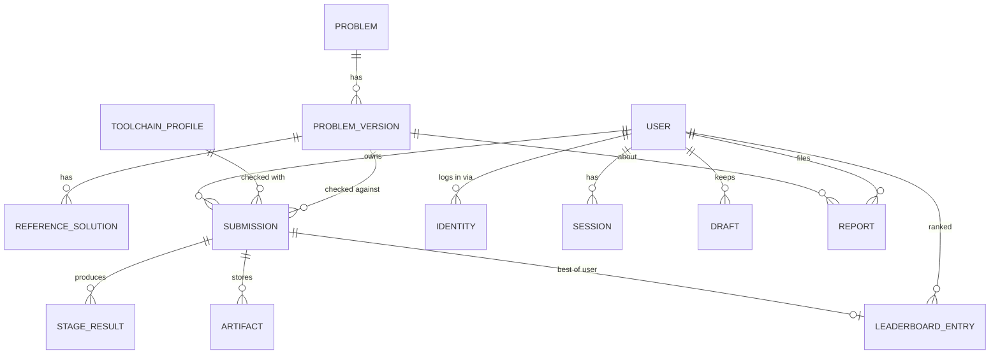

# 04. Доменная модель и схема БД

## 1. Инварианты, обязательные с Ф0

1. Версия задачи неизменяема после публикации. Повторный импорт той же `(slug, version)` с другим `content_hash` отклоняется.
2. Отправка хранит `problem_version_id`, `toolchain_profile_id`, `seed`. Любой прогон воспроизводим.
3. Результаты проверки хранятся обобщённо: `stage_results` со `stage_type`, `status`, `metrics` (JSONB) и `metrics_schema`. Новый этап не меняет схему БД.
4. Ядро (задачи, отправки, этапы, рейтинги) не содержит знаний о SystemVerilog: язык — строка `language` в версии задачи и в профиле тулчейна.

Таблицы и поля под будущие фазы заранее не создаются. Ниже у каждой таблицы указана фаза появления.

## 2. Сущности и связи



## 3. Перечисления

### 3.1 Статус отправки (`submission_status`)

Статус — единственное поле для UI. Соответствие макетам и `components.md`:

| Значение | Текст в UI | Когда |
|---|---|---|
| `queued` | В очереди · позиция N | создана, ждёт воркера |
| `running` | Выполняется · этап, время | воркер взял задачу |
| `accepted` | Принято | все этапы `passed` |
| `accepted_with_warnings` | Предупреждения линта / Принято с замечаниями | все обязательные этапы пройдены, у линта или формала `warning` (решение принято). Подпись зависит от источника: только линт — «Предупреждения линта», иначе «Принято с замечаниями» |
| `wrong_answer` | Неверный ответ | упал тест или нарушено свойство |
| `compile_error` | Ошибка компиляции | slang/Verilator не собрали решение, **или** решение не синтезируется / содержит запрещённые синтезом конструкции (латчи при `forbid_latches`); этап-источник виден в конвейере (решение ОВ-9) |
| `limit_exceeded` | Превышен лимит | время, память, объём вывода, размер трассы; вид — в `verdict_detail.limit` |
| `forbidden_construct` | Запрещённая конструкция | статическая проверка нашла запрещённое |
| `cancelled` | Отменено | пользователем или новым Run |
| `internal_error` | Внутренняя ошибка | сбой платформы; отправка не засчитывается и не расходует лимит |

Для `run` статус `accepted` означает «открытые тесты пройдены»; UI подписывает его «Принято · открытые тесты». В рейтинг попадают только `submit` со статусом `accepted` или `accepted_with_warnings`.

### 3.2 Статус этапа (`stage_status`)

Восемь состояний `PipelineStage` из `components.md`:

`pending` (ожидает) · `running` (идёт) · `passed` (чисто) · `warning` (предупреждение) · `failed` (ошибка) · `skipped` (пропущен, причина в `summary.skip_reason`) · `cancelled` (отменён) · `error` (сбой платформы).

### 3.3 Агрегация вердикта

Вычисляется ядром по списку этапов, без знания языка. Каждый этап при `failed` сообщает `failure_kind` из закрытого списка: `forbidden`, `compile`, `wrong`, `limit`.

```
если отправка отменена             → cancelled      (первым: отмена может оборвать этап с error)
если есть этап error              → internal_error
первый failed по порядку этапов:
  failure_kind=forbidden           → forbidden_construct
  failure_kind=compile             → compile_error
  failure_kind=wrong               → wrong_answer
  failure_kind=limit               → limit_exceeded
иначе, если есть warning           → accepted_with_warnings (источники — в verdict_detail.warnings)
иначе                              → accepted
```

## 4. Схема БД

PostgreSQL 17+. Первичные ключи — UUIDv7 (сортируемы по времени), кроме справочников. Время — `timestamptz`. Метрики и сводки — `jsonb`.

### Ф0 — ядро задач и проверок

**`tags`** — справочник тегов из репозитория задач.
`slug text pk`, `title text`, `sort int`.

**`problems`**
`id uuid pk`, `slug text unique`, `number int unique` (номер в каталоге), `current_version_id uuid null fk`, `is_published bool`, `created_at`.

**`problem_versions`**
`id uuid pk`, `problem_id fk`, `version int`, `content_hash text` (sha256 пакета), `language text` (`systemverilog`), `kind text` (`design`), `title text`, `difficulty text` (ключ из конфига уровней), `tags text[]`, `statement_md text`, `template text`, `changelog text null`, `interface jsonb`, `manifest jsonb` (весь `problem.yaml`), `package_uri text` (ключ в S3), `resource_class text`, `leaderboard_epoch int`, `published_at`.
Уникальность `(problem_id, version)`. Индекс GIN по `tags`.

**`reference_solutions`**
`id uuid pk`, `problem_version_id fk`, `title text`, `code text`, `explanation_md text`, `metrics jsonb null` (заполняется после прогона эталона на профиле).

**`toolchain_profiles`**
`id text pk` (например `sv-2026.10`), `image text`, `image_digest text`, `tools jsonb` (версии), `liberty text`, `normalization_version int`, `is_default bool`, `created_at`.

**`submissions`**
`id uuid pk`, `problem_version_id fk`, `guest_id uuid null`, `kind text` (`run`/`submit`), `code text` (как прислал пользователь), `code_hash text null` (sha256 канонического текста, ключ кэшей), `ast_hash text null`, `seed bigint`, `toolchain_profile_id fk`, `status submission_status`, `verdict_detail jsonb` (например `{limit: "output", first_failure: {stage, test, cycle}}`), `queue_class text`, `attempt int`, `created_at`, `started_at`, `finished_at`, `client_ip_hash text`.
Индексы: `(guest_id, created_at desc)`, `(problem_version_id, status)`, `(ast_hash)`.

**`stage_results`**
`id uuid pk`, `submission_id fk`, `stage_key text` (уникален в пайплайне: `lint`, `sim`, `synth`…), `stage_type text`, `ordinal int`, `status stage_status`, `failure_kind text null`, `started_at`, `finished_at`, `duration_ms int`, `metrics jsonb`, `metrics_schema text` (например `synth/v1`), `summary jsonb` (тесты, свойства, диагностики, причина пропуска), `error_code text null`.
Уникальность `(submission_id, stage_key)` — ингестор делает upsert, повторная доставка идемпотентна.

**`artifacts`**
`id uuid pk`, `submission_id fk`, `stage_key text null`, `kind text` (`log`, `events`, `fst`, `netlist_json`, `netlist_v`, `tb_result`, `synth_report`, `formal_trace`), `storage_key text`, `size_bytes bigint`, `sha256 text`, `expires_at timestamptz null`, `created_at`.

**`feature_flags`**
`key text pk`, `enabled bool`, `rules jsonb` (роли, доля пользователей), `updated_at`.

### Ф1 — гостевой режим

Изменений схемы нет: `guest_id` есть с Ф0. Добавляется очистка гостевых отправок старше 14 дней (решение ОВ-13).

### Ф2 — пользователи

**`users`**: `id uuid pk`, `nick citext unique`, `display_name text`, `avatar_url text`, `email citext null`, `role text` (`user`, `author`, `moderator`, `admin`), `is_hidden bool`, `created_at`, `deleted_at null`.

**`identities`**: `id`, `user_id fk`, `provider text`, `subject text`, `email text null`, `created_at`. Уникальность `(provider, subject)`.

**`sessions`**: `id_hash text pk` (sha256 от токена cookie), `user_id fk`, `created_at`, `expires_at`, `last_seen_at`, `user_agent text`.

**`email_tokens`**: `token_hash text pk`, `email citext`, `purpose text`, `expires_at`, `used_at null`.

**`drafts`**: `user_id fk`, `problem_id fk`, `code text`, `problem_version int`, `updated_at`; pk `(user_id, problem_id)`.

**`user_problem_status`**: `user_id`, `problem_id`, `status` (`attempted`/`solved`), `first_solved_at`, `last_submission_id`; pk `(user_id, problem_id)`. Обновляется ингестором.

Миграция `submissions`: `user_id uuid null fk`, индекс `(user_id, created_at desc)`, `imported_from_guest bool default false`.

### Ф3 — качество решений

**`leaderboard_entries`**: `id`, `problem_id fk`, `leaderboard_epoch int`, `toolchain_profile_id fk`, `formula_version int`, `user_id fk`, `submission_id fk`, `sort_values numeric[]` (значения метрик в порядке формулы, округлённые до точности инструмента; равные массивы — равное место), `ast_hash text`, `group_leader_entry_id uuid null` (самая ранняя запись с тем же хэшем), `rank int null` (у ведущей записи группы), `submitted_at`, `updated_at`.
Уникальность `(problem_id, leaderboard_epoch, toolchain_profile_id, formula_version, user_id)`. Индекс `(problem_id, leaderboard_epoch, toolchain_profile_id, formula_version, sort_values, submitted_at)`.

**`user_ratings`**: `user_id pk`, `points int`, `solved_by_difficulty jsonb`, `rank int`, `formula_version int`, `updated_at`. Пересчитывается ингестором; снимки для «+5 за неделю» — `user_rating_snapshots(user_id, date, rank)`.

Миграция `submissions`: `is_public bool` (true для принятых Submit вошедших пользователей), `is_hidden bool` (модерация).

**`moderation_log`**: `id`, `actor_id`, `action text`, `target_type text`, `target_id text`, `reason text`, `created_at`. Нужна к публичной бете вместе со скрытием решений и пользователей.

### Ф5 — модерация

**`reports`**: `id`, `problem_version_id fk`, `user_id fk null`, `guest_id null`, `category text` (`statement`, `test`, `tooling`, `other`), `text text`, `status text` (`open`, `in_review`, `resolved`, `rejected`), `resolution text null`, `moderator_id null`, `created_at`, `resolved_at`.

**`rejudge_batches`**: `id`, `scope jsonb` (задача, эпоха, профиль или список отправок), `status`, `total int`, `done int`, `created_by`, `created_at`.

Миграция `submissions`: `rejudge_of uuid null` — перепроверка создаёт новую отправку, старая сохраняется.

### Ф7 — индустриальный режим

Миграция `submissions`: `mode text not null default 'practice'`. Миграция `leaderboard_entries`: `mode` в ключе уникальности. Новая таблица `industrial_progress(user_id, problem_id, step_key, status, submission_id)`. Новые этапы (`tb_coverage`, `mutation`, `assertions`, `timing_closure`, `signoff`) — только новые `stage_type` и схемы метрик, без изменения `stage_results`.

## 5. Схемы метрик этапов

Версионируются по типу этапа. JSON Schema — в `judge/schemas/metrics/` (создаётся в Ф0 для `precheck`, `lint`, `sim`; в Ф3 — `synth`; в Ф5 — `formal`).

| `metrics_schema` | Поля |
|---|---|
| `precheck/v1` | `ast_hash`, `normalization_version`, `module`, `ports_ok` |
| `lint/v1` | `warnings`, `errors`, `rules: {CODE: count}` |
| `sim/v1` | `tests_total`, `tests_passed`, `cycles`, `seed`, `first_failure: {test, cycle, signal}` |
| `synth/v1` | `critical_path_ns`, `fmax_mhz`, `area_um2`, `cells`, `flops`, `latches`, `logic_depth`, `liberty` |
| `formal/v1` | `properties_total`, `proved`, `failed`, `unknown`, `depth` |

`summary` хранит списки для UI: тест-кейсы (`sim`), диагностики с `file:line:col` (`lint`, `precheck`), свойства (`formal`).

## 6. Хранение кода и приватность

- Код Run и непринятых Submit виден только автору (и модераторам). Принятый Submit вошедшего пользователя публичен (`is_public`): метрики и автор видны всем, код — пользователям с собственным Accepted по этой задаче (решение ОВ-2).
- Гостевые отправки не публичны, не участвуют в рейтингах и удаляются через срок хранения.
- При удалении аккаунта: персональные данные удаляются, публичные решения анонимизируются (`user_id` → служебный пользователь «удалённый участник»). Решение ОВ-12.
