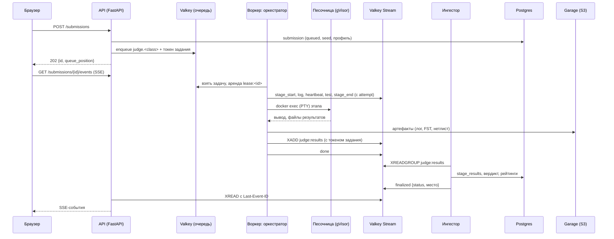

# 07. Пайплайн проверки, стриминг логов, песочница

## 1. Поток отправки



Воркер не имеет доступа к Postgres и секретам API: он видит только Valkey (очередь и стримы) и свои бакеты в объектном хранилище. **Итоговый статус отправки определяет только ингестор** (событие `finalized`); воркер сообщает результаты этапов. Решения — ADR-0002 и ADR-0009.

## 2. Этапы

Каждый этап — плагин языкового модуля (`judge/languages/systemverilog/stages/`). Ядро (`judge/core`) не знает SystemVerilog.

```python
class Stage(Protocol):
    stage_type: ClassVar[str]                  # "lint", "sim", ... (`type` в stages.<key>)
    config_model: ClassVar[type[BaseModel]]    # валидирует stages.<key> из problem.yaml
    metrics_schema: ClassVar[str]              # "sim/v1"

    def plan(self, ctx: StageContext) -> StagePlan: ...
    #   команды (argv, cwd, лимиты), которые надо выполнить в песочнице,
    #   входные файлы и какие выходные файлы забрать
    def interpret(self, ctx: StageContext, run: ExecResult) -> StageOutcome: ...
    #   статус, failure_kind, metrics, summary, диагностики — по кодам выхода и файлам
```

`StageContext`: конфиг этапа, интерфейс задачи, сид, вид отправки (`run`/`submit`), результаты и выходные файлы предыдущих этапов. `Executor` (локальный Docker, песочница, без Docker) исполняет `StagePlan` и стримит вывод в `EventSink`. Один и тот же код работает в CLI, CI и воркере. Функция агрегирования вердикта — тоже в `judge.core`; её вызывают CLI и ингестор, воркер — нет.

### 2.1 `precheck` — статическая проверка (pyslang)

Выполняется до любого исполнения пользовательского кода, в песочнице, как остальные этапы. Принцип — **белый список**: разрешено только синтезируемое подмножество, всё остальное — `failed`, `failure_kind=forbidden` с указанием строки.

1. **Препроцессор запрещён целиком.** Любая директива с обратным апострофом (`` `define ``, `` `ifdef ``/`` `ifndef ``/`` `elsif ``/`` `else ``/`` `endif ``, `` `undef ``, `` `include ``, `` `timescale ``, `` `default_nettype ``, `` `resetall ``, `` `celldefine ``, `` `line ``, `` `pragma ``, `` `systemc_* `` и т. д.) → `forbidden`. Так исключается код, видимый одному инструменту и невидимый другому (`` `ifdef SYNTHESIS ``, `` `ifdef VERILATOR ``). Вместо макросов — `localparam`. Проверяется лексером slang **до разбора**: разбор запускает препроцессор, который прочитал бы `` `include `` и раскрыл макросы; лексер отдаёт директивы и макросы отдельными токенами, не выполняя их (S7).
2. **Канонический текст.** Решение разбирается slang отдельно от тестбенча; синтаксические ошибки → `failed`, `failure_kind=compile`, диагностики с `file:line:col` (структурированные диагностики slang, а не разбор текста). Затем из синтаксического дерева печатается канонический текст **без комментариев** — `solution.sv`. Все следующие этапы получают только его, исходный текст пользователя в инструменты не попадает. Поэтому комментарии-директивы (`// synthesis translate_off`, `// verilator lint_off`, `/* verilator public */` и любые будущие) не могут повлиять ни на один инструмент. Номера строк и колонок сохраняются — текст печатается из токенов, каждый символ комментария заменяется пробелом, переводы строк остаются, — чтобы диагностики всех инструментов указывали на код пользователя.
3. **Состав:** ровно один модуль с именем `top`. Запрещены: вложенные и дополнительные модули, `interface`, `program`, `package`, `class`, `checker`, `let`, `bind`, `config`, `primitive`, `specify`, объявления в `$unit` вне модуля, инстанцирование любых модулей, `import`, DPI, атрибуты `(* … *)`, иерархические ссылки за пределы модуля и `$root`.
4. **Разрешённые конструкции:** порты и параметры, `localparam`, `typedef`, `enum`, `struct packed`, `union packed`, переменные `logic`/`bit`/`wire`/`reg`/целочисленные типы, упакованные и распакованные массивы; `assign`; `always_comb`; `always_ff` и `always @(…)`/`always @*` только с управлением по событию первым оператором (без задержек); `generate`, `for`/`if`/`case` в generate; функции `automatic` без управления временем; `if`, `case`/`casez`/`casex`, `unique`/`priority`, `for` с константными границами, `break`/`continue`; все операторы выражений.
5. **Запрещено дополнительно** (не синтезируется или расходится между симуляцией и синтезом): `initial`, `final`, `always_latch`, задержки `#`, `wait`, `fork`/`join`, события `->`/`@`-внутри тела, `force`/`release`, процедурные `assign`/`deassign`, задачи (`task`), типы `real`/`shortreal`/`realtime`/`string`/`chandle`/`event`, `$random`/`$urandom*`, `$time`/`$realtime`.
6. **Системные задачи и функции** — только `$clog2`, `$bits`, `$size`, `$left`, `$right`, `$high`, `$low`, `$signed`, `$unsigned`, `$countones`, `$onehot`, `$onehot0`, `$display`, `$write`. (`$error`/`$warning`/`$info` исключены: `$error` в Verilator по умолчанию останавливает симуляцию; `$isunknown` бессмыслен в двухзначном Verilator.)
7. **Интерфейс:** имена, направления, ширины (вычисленные при параметрах по умолчанию), знаковость портов и имена параметров совпадают с `problem.yaml`.
8. **Лимиты:** код ≤ 64 КБ, ≤ 2000 строк; элаборация slang с таймаутом этапа и ограничениями шагов `generate` и константных вычислений (защита от «взрыва» элаборации); суммарный объём переменных и цепей решения после элаборации (по умолчанию ≤ 2²⁰ бит) — распакованные массивы огромного размера slang принимает, а Verilator выделил бы под них память (S7). Значения — в конфигурации этапа.
9. **Хэши:** `code_hash` — sha256 канонического текста (ключ кэшей, §2.4–2.6); `ast_hash` — нормализованный AST-хэш (§6, только для группировки и модерации).

Белый список проверяется по видам узлов синтаксического дерева slang (`SyntaxKind`), а не регулярными выражениями. Новый вид узла по умолчанию запрещён. Имена видов в списке проверяются при загрузке модуля: опечатка или вид, удалённый в новой версии slang, — ошибка, а не молча пропущенное правило. Системные имена, `::`, `$unit` и `$root` проверяются по токенам; ссылки вверх по иерархии ловит элаборация решения отдельно от тестбенча (имя не объявлено). Отчёт — [docs/spikes/s7.md](../docs/spikes/s7.md).

**Исполнение.** pyslang разбирает код атакующего, поэтому проверка выполняется в песочнице: этап загружает в каталог этапа решение, `job.json` (имя модуля, параметры и порты из `problem.yaml`, лимиты из конфигурации этапа) и раннер `judge/languages/systemverilog/sandbox/precheck_runner.py` — один файл на стандартной библиотеке и pyslang образа — и забирает `result.json` и канонический текст. Оба файла недоверенные: размер ограничен, `result.json` разбирается по строгой схеме, нарушение — `error` с `OUTPUT_INVALID`. `code_hash` судья считает сам по полученному каноническому тексту. Интерфейс проверяется при значениях параметров по умолчанию из `problem.yaml` (а не из решения): ширины портов задачи вычисляет slang. Итог: запрещённые конструкции, директивы, системные имена, `::`/`$root`, правила `always`/функций → `forbidden`; синтаксис, число и имя модулей, элаборация, интерфейс, кодировка → `compile`; размер кода → `limit` (`size`), объём состояния → `limit` (`memory`). Сообщения — по-русски, у каждой диагностики стабильный `code` (`PREPROCESSOR`, `CONSTRUCT`, `PORT_WIDTH`…).

### 2.2 `lint` — Verilator `--lint-only`

- Только канонический `solution.sv` из `precheck`. Команда: `verilator --lint-only -Wno-fatal <flags> -Wno-DECLFILENAME --top-module <top> --diagnostics-sarif --diagnostics-sarif-output lint.sarif solution.sv`. `flags` — из конфига этапа, только опции предупреждений `-W…` (по умолчанию `-Wall -Wno-UNUSEDPARAM`); `-Wno-DECLFILENAME` добавляется всегда (файл всегда `solution.sv`), `-Wno-fatal` — чтобы предупреждения не меняли код выхода.
- Диагностики — через `--diagnostics-sarif` (структурированный вывод), а не разбор текста. Ошибки → `failed`, `failure_kind=compile`. Предупреждения → `warning` (решение не валится, если `warnings_fail: false`). Метрики `lint/v1`: `warnings`, `errors`, `rules`. SARIF — недоверенный файл: лимит размера (превышение — `limit`/`output`), строгая схема нужных полей. Verilator 5.052 пишет SARIF без запятой после пустого списка `rules` (чистый прогон или только ошибки) — этап исправляет ровно это место перед разбором.
- Диагностики → `summary.diagnostics[] = {severity, code, file, line, col, message}` → маркеры Monaco и ссылки в консоли.
- Verible lint — опционально (`verible: true`), обязателен в индустриальном режиме.

### 2.3 `sim` — сборка и симуляция (Verilator)

1. Сборка: `apx-verilate --quiet -MAKEFLAGS -s --timescale 1ps/1ps --x-assign unique --x-initial unique -j N -Wno-fatal -Wno-lint /opt/apx/sv/apx_tb_pkg.sv <tb sources> <design> --top-module <tb.top>` (`N` — `build_jobs` этапа, по умолчанию 1: с предсобранным рантаймом параллельная сборка не окупается, S2; `--quiet -MAKEFLAGS -s` убирают из консоли отчёт Verilator и команды `make`, ошибки остаются), где `<design>` — канонический `solution.sv` (или нетлист для `netlist_sim`, §2.5). `apx-verilate` — обёртка образа: добавляет флаги `--binary --timing --trace-fst` и подключает рантайм Verilator, предсобранный в образе для этих флагов (ADR-0003); рантайм на отправку не компилируется. Библиотека тестбенча `apx_tb_pkg` идёт первой (06 §3.2); `--timescale` задаёт единицы модулям без `timescale` — решению (его `timescale` запрещён) и тестбенчу, если автор его не указал, — и убирает предупреждение `TIMESCALEMOD` рядом с пакетом, у которого единицы свои.
2. Кэш сборки: оркестратор копирует бинарник **до первого запуска** и кладёт в бакет `build-cache` по ключу `(code_hash, problem_version, toolchain_profile, design)` на 24 ч. Run → Submit без изменений кода не пересобирает.
3. Прогон: `./Vtb +apx_seed=<seed> +apx_groups=<...> +apx_result=tb_result.jsonl +apx_nonce=<n> +apx_max_cycles=<max_cycles> +verilator+seed+<s> +verilator+rand+reset+2 +verilator+quiet`, где `s = seed mod (2³¹−1) + 1`: Verilator принимает положительный `int`, а `0` означал бы случайный сид. Сборка и прогон — один план этапа (общий таймаут); исходники тестбенча кладутся в `pkg/<путь в пакете>`, решение — `solution.sv` (или `design.v` для `design`). Неинициализированные переменные и регистры получают случайные значения, зависящие от сида: решение, которое полагается на начальное состояние вместо сброса, не проходит тесты. Лимит тактов — `max_cycles` (библиотека тестбенча, `suite_abort`), лимит времени — таймаут этапа.
4. Интерпретация: файл результатов (с лимитом размера до разбора, `tbproto.parse_result`) → `summary.tests[]`, `metrics` (`sim/v1`). Падение теста → `failed`, `failure_kind=wrong`. Нет `suite_end` → см. 06 §3.3.
5. **Трасса при падении.** После провала оркестратор перезапускает тот же бинарник с тем же сидом и `+apx_trace_from=max(0, T-W) +apx_trace_to=T+W'` (по умолчанию W=64, W'=16 тактов; T — такт первого расхождения). `apx_tb_pkg` вызывает `$dumpvars` на такте начала окна и `$finish` на такте конца (Verilator игнорирует `$dumpoff`/`$dumpon`); в остальном прогон идёт так же, как первый. Оркестратор сверяет первое расхождение повторного прогона с первым: несовпадение — недетерминированный тестбенч (ошибка задачи, алерт), окно не показывается (ADR-0004). Результат — FST-артефакт с лимитом `fst_mb`. Для скрытых тестов и для `design` (нетлист) трасса не пишется. Повторный прогон выполняется в том же каталоге этапа (собранный бинарник уже там), его вывод в консоль не идёт; вердикт остаётся от первого прогона, а `metrics.trace` говорит, чем кончилась запись: `recorded` (+ `trace_window`), `too_large`, `missing`, `nondeterministic`, `failed`.
6. Трасса по запросу (Run): «Записать волны целиком» → повторный прогон с трассой всего теста (лимит размера; при превышении — состояние «слишком большой файл»). Расходует отдельную квоту (§3).
7. Если тестбенч задачи использует constrained randomization (`randomize()` с ограничениями), Verilator во время исполнения запускает решатель Z3: он входит в образ и `versions.lock`, учитывается в `pids-limit`. Авторам рекомендуется генерировать стимулы через `$urandom` — это быстрее и проще для детерминизма (06 §3.1).
8. **Прогресс и скрытые тесты.** Строки `@@apx` превращаются в события `test`; тесты групп, кроме `public`, в них и в `summary` анонимны (`hidden-1`, …, без имени), их итог — `summary.hidden_tests` (`total` из `testbenches[].groups`, `passed`, `failed_index`).

### 2.4 `synth` — синтез (Ф3)

Скрипт Yosys (детали — ADR-0007, уточняются спайком S4):

```
plugin -i slang
read_slang --no-synthesis-define --no-default-translate-off-format \
           solution.sv --top <top> -G WIDTH=8 -G DEPTH=16
synth -top <top> -flatten
write_verilog -noattr netlist_generic.v      → вход этапа netlist_sim (§2.5)
dfflibmap -liberty <lib>
abc -liberty <lib>
hilomap -hicell … -locell … ; splitnets -ports ; opt_clean
stat -liberty <lib> -json                    → area_um2, cells
select -assert-none t:$*latch*               → latches (при forbid_latches — failed, failure_kind=compile)
ltp -noff                                    → logic_depth
write_verilog -noexpr -noattr netlist.v ; write_json netlist.json
```

Затем OpenSTA по смапленному нетлисту с **фиксированными** ограничениями из образа (не из решения): `create_clock` на порт с ролью `clock` с периодом `clock_period_ns`, `set_driving_cell` и `set_load` на все порты, `set_input_delay`/`set_output_delay` 0; для комбинационных задач — `set_max_delay` вход → выход. Худший путь → `critical_path_ns`, `fmax_mhz = 1000 / critical_path_ns`. Ошибка `read_slang` или несинтезируемая конструкция → `failed`, `failure_kind=compile`, сообщение «решение проходит симуляцию, но не синтезируется: …».

Кэш результата — по ключу `(code_hash, problem_version, toolchain_profile)`.

### 2.5 `netlist_sim` — симуляция нетлиста (Ф3)

Проверяет, что синтезированная схема — та же, что прошла тесты. Без этого этапа рейтинг PPA можно подделать решением, которое в симуляции ведёт себя иначе, чем после синтеза.

- Тип этапа — тот же плагин `sim` с параметром `design: synth.netlist_generic`: нетлист из Yosys до привязки к библиотеке (внутренние вентили Yosys, выведенные `write_verilog` выражениями) не требует моделей ячеек Nangate45.
- Тот же тестбенч, тот же сид, группы `public` и `hidden`, те же плюс-аргументы случайной инициализации.
- Расхождение → `failed`, `failure_kind=wrong`, сообщение «синтезированная схема ведёт себя иначе, чем исходный код: тест N, такт T». Трасса не пишется (нетлист нечитаем для пользователя); показывается подсказка о типичных причинах (зависимость от начального состояния, неполный сброс).
- Входит в `pipelines.practice.submit` после `synth`; принятое решение без пройденного `netlist_sim` в рейтинг не попадает (проверяется ингестором). В конвейере UI отображается внутри блока «Синтез» (08 §6).
- Кэш — как у `synth`.

### 2.6 `formal` — SymbiYosys (Ф5)

- Сборка `sby`-проекта из шаблона пакета: канонический `solution.sv` + `formal/props.sv` + `bind`. Чтение через `read_slang` с теми же флагами, что в синтезе (если S1 подтвердит) или `read -formal` для файла свойств.
- Режим `prove` (k-индукция), при неудаче — `bmc` до `depth` для контрпримера.
- Итог по каждому свойству: `proved`, `failed` (глубина контрпримера, трасса → FST), `unknown` (таймаут). Любое `failed` → этап `failed`, `failure_kind=wrong`. `unknown` → `warning` с пояснением.
- Кэш — по `(code_hash, problem_version, toolchain_profile)`.

### 2.7 Ранняя остановка и пропуски

- Этап после `failed` или `error` не запускается: статус `skipped`, `summary.skip_reason = "previous_failed"`.
- Run не запускает синтез, симуляцию нетлиста и формал (их нет в `pipelines.practice.run`); метрики синтеза появляются только после Submit (решение ОВ-10).

## 3. Очереди, воркеры, отмена

- Брокер — Valkey (инстанс `valkey-queue`, `noeviction`, AOF), библиотека Dramatiq ≥ 2.2 (ADR-0002). Очереди `judge.light`, `judge.heavy`, `judge.rejudge`; имя выводится из `resource_class`, перепроверки всегда идут в `judge.rejudge`. На старте один пул воркеров слушает все очереди, но для `judge.rejudge` у каждого воркера отдельный лимит слотов (по умолчанию 1), чтобы массовая перепроверка не вытесняла живых пользователей.
- Позиция в очереди — собственный sorted set `queue:<class>` (score = время постановки); `ZRANK` даёт позицию, ETA = позиция × p50 длительности / активные слоты. Публикуется в стрим отправки раз в 2 с, пока отправка ждёт.
- Каждый воркер обслуживает `slots` проверок одновременно (по умолчанию = число ядер / 2).
- **Ретраи — один владелец.** Актор Dramatiq объявлен с `max_retries=0`. Перепостановку при гибели воркера выполняет только Redis-брокер Dramatiq (heartbeats брокера). Перед стартом оркестратор берёт аренду `SET lease:<id> <worker> NX EX 15` и продлевает её каждые 5 с; если аренда занята — дубль сообщения отбрасывается. Счётчик попыток `attempts:<id>` увеличивается при каждом старте; на третьей попытке оркестратор не запускает проверку, а сообщает `attempt_failed` с итогом `internal_error`.
- **Watchdog** в ингесторе — только страховка: отправка в `running` без аренды дольше суммарного лимита проверки и без события `done` → `internal_error`. Сам он ничего не перепоставляет.
- **Периодические задачи и watchdog** выполняет один экземпляр ингестора: блокировка лидера `SET leader:ingest NX EX 30` с продлением.
- **Суммарный лимит проверки** = сумма таймаутов этапов + накладные (30 с). Dramatiq-сообщение подтверждается после завершения.
- **Отмена.** `POST /submissions/{id}/cancel` ставит ключ `cancel:<id>`. Новый Run той же задачи тем же пользователем/гостем отменяет предыдущий незавершённый Run. Оркестратор проверяет ключ при старте и подписан на канал отмены во время работы; отмена = `kill` контейнера песочницы (убивает всё дерево процессов). Этапы получают `cancelled`, в лог — «cancelled: new run started — sandbox process tree killed».
- **Квоты** (конфиг `config/limits.yaml`, значения по умолчанию утверждены — ОВ-11): гость — 10 проверок в час, 1 одновременная; пользователь — 60 в час, 2 одновременные; тяжёлые — 20 в сутки, гостям недоступны. Перезапись волн (§2.3 п. 6, FR-WAV-05) — отдельная квота: пользователь 20 в час, гость 5 в час, полная трасса теста — только вошедшим. `internal_error` не расходует квоту. Реализация — библиотека `limits` с хранилищем в `valkey-cache`.

## 4. Стриминг логов и прогресса

Цепочка: **процесс в песочнице → PTY → оркестратор → Valkey Stream → API (SSE) → `EventSource`** (ADR-0008).

### 4.1 Стрим отправки

Ключ `sub:<submission_id>`, `MAXLEN ~ 5000`. Каждая запись — поле `e` с JSON-событием. ID записи = `id` события SSE. Формы событий совпадают со схемой `SubmissionEvent` в OpenAPI. Во всех событиях воркера есть поле `attempt`: при новой попытке клиент сбрасывает состояние панели результатов.

| Тип | Кто пишет | Поля | Назначение |
|---|---|---|---|
| `queue` | API | `position`, `eta_s` | позиция в очереди |
| `stage_start` | воркер | `attempt`, `stage`, `stage_type`, `ordinal` | этап начат |
| `log` | воркер | `attempt`, `stage`, `ch` (`out`/`err`/`sys`), `text` | текстовая порция; склейка ~75 мс или 8 КБ |
| `heartbeat` | воркер | `attempt`, `stage`, `elapsed_ms`, `note` | раз в 1 с на «молчаливых» шагах (компиляция C++, ABC, SAT) |
| `test` | воркер | `attempt`, `test: TestCase` | прогресс тестов из строк `@@apx` |
| `stage_end` | воркер | `attempt`, `result: StageResult` | этап завершён; частичные результаты видны сразу |
| `truncated` | воркер | `attempt`, `stage`, `limit_kb` | вывод обрезан |
| `done` | воркер | `attempt` | пайплайн завершён, итог считает ингестор |
| `finalized` | ингестор | `status`, `verdict_detail`, `leaderboard?` | итоговый статус, место в рейтинге; клиент показывает баннер вердикта по этому событию |

### 4.2 SSE-эндпоинт

- `GET /api/v1/submissions/{id}/events`, `Last-Event-ID` или `?from=<id>` для дочитывания.
- Каждый процесс API держит **один** читатель стримов: он делает `XREAD BLOCK` сразу по всем стримам, на которые есть подписчики, и раздаёт события подписчикам в памяти. Соединение Valkey на каждого клиента не открывается.
- Комментарий `: keepalive` каждые 15 с.
- После `finalized` стрим живёт ещё 10 минут (`EXPIRE`). Затем эндпоинт отдаёт события из артефакта `events.jsonl.zst` с той же нумерацией.
- Уход со страницы не прерывает проверку. При обрыве клиент переподключается с экспоненциальной задержкой (1, 2, 4, 8, 15 с; максимум 5 попыток, затем «Подключиться сейчас») — состояние «обрыв» в `ResultStates`.
- Прокси: `proxy_buffering off`, `X-Accel-Buffering: no`, HTTP/2.

### 4.3 PTY и лимиты вывода

- Каждая команда этапа запускается через `docker exec` с выделенным TTY, чтобы `$display` и лог Yosys шли построчно. stderr при TTY сливается со stdout; канал `err` назначается обёрткой `apx-run` в образе (она даёт команде отдельные псевдотерминалы для stdout и stderr и помечает каждую строку stderr байтом `0x1E` в начале) и разбором строк (`%Error`, `ERROR:`).
- Лимит вывода этапа (`output_kb`, по умолчанию 1 МБ). Превышение → процесс убивается, этап `failed`, `failure_kind=limit`, `verdict_detail.limit = "output"`; в стрим — `truncated`, в консоль — первые N и последняя строка. Полный лог до обрезки — в артефакте.
- Лог Yosys в консоль идёт в сокращённом виде (фильтр по уровню из конфига этапа); полный — в артефакт.

### 4.4 Жизненный цикл

По завершении оркестратор загружает в бакет `artifacts`: `logs/<stage>.log.zst`, `events.jsonl.zst`, FST, нетлисты, отчёты. Ключи — `<yyyy>/<mm>/<submission_id>/…`. Срок хранения (правила жизненного цикла хранилища): FST — 7 дней (затем пересоздаётся по запросу), логи и события — бессрочно для Submit, 30 дней для Run, нетлисты — бессрочно для принятых Submit. Пользователю файлы отдаются по presigned URL с `Content-Type: application/octet-stream` и `Content-Disposition: attachment`.

## 5. Песочница и модель доверия

Решение — ADR-0003. Verilator превращает код пользователя в C++ и исполняет его; Yosys, SBY и slang разбирают код атакующего. Поэтому **недоверенными считаются все этапы и все их выходные файлы**.

### 5.1 Контейнер

| Мера | Значение |
|---|---|
| Рантайм | gVisor `runsc`, платформа `systrap` (в разработке на Windows/macOS допускается `runc` с теми же ограничениями, флаг `SANDBOX_RUNTIME`) |
| Контейнер | одноразовый, на одну отправку; создаётся и удаляется помощником `apx-sandboxd` (§5.3); PID 1 — `apx-init` из образа: забирает осиротевшие процессы и не завершается (S6) |
| Сеть | `--network=none` |
| ФС | `--read-only`; `/work` — tmpfs (`size=512m`, `exec`); пакет задачи — read-only bind; `/tmp` — tmpfs 64 МБ |
| Пользователь | непривилегированный UID, `--cap-drop=ALL`, `--security-opt=no-new-privileges` |
| Ресурсы | `--cpus` (по умолчанию 2), `--memory` (2 ГБ, без swap), `--pids-limit=256`, `ulimit -f`, таймаут этапа |
| Секреты | нет переменных окружения с секретами, нет docker socket, нет доступа к хранилищу |

### 5.2 Между этапами

- Каждый этап работает в собственной чистой директории `/work/<stage>/`. Входные файлы (канонический `solution.sv`, пакет задачи, нужные выходы предыдущих этапов) оркестратор кладёт туда сам, только для чтения, — потоком tar через `exec` (`docker cp` не пишет в tmpfs).
- После каждого этапа оркестратор убивает все процессы непривилегированного пользователя в контейнере (`docker exec -u sandbox <c> sh -c 'kill -KILL -1'` — встроенная команда оболочки, `/bin/kill` в образе нет) — фоновый процесс, оставленный бинарником симуляции, не доживёт до синтеза. PID 1 (`apx-init`) от этого сигнала защищён ядром и забирает зомби. Так же прерывается этап при превышении лимита вывода: если убить только клиент `docker exec`, процесс в контейнере продолжит работать (S6).
- Выходные файлы этапов (`tb_result.jsonl`, `stat.json`, отчёты OpenSTA и SBY, логи, FST) оркестратор читает как недоверенные: сначала проверка размера, затем разбор по схеме; ошибка разбора → этап `error` с кодом `OUTPUT_INVALID` (не `wrong`, чтобы не вводить пользователя в заблуждение, и с алертом).
- Честность вердикта и метрик держится на трёх механизмах, а не на изоляции этапов друг от друга: статическая проверка (§2.1), авторитетный файл результатов тестбенча (06 §3.3) и симуляция нетлиста (§2.5). Отдельные контейнеры для этапов не используются (ADR-0003).

### 5.3 Права воркера

- Оркестратор не получает docker socket. Контейнерами управляет `apx-sandboxd` — небольшой процесс на хосте воркера с фиксированным набором операций (`create` с жёстко заданными флагами §5.1, `put` — tar-поток в `/work`, `exec`, `kill` — процессы пользователя песочницы, `destroy`), доступный оркестратору через unix-socket. Идентификаторы контейнеров выдаёт демон, ссылаться можно только на свои; аргументы `exec` идут после имени контейнера и не могут стать флагами Docker. Ошибка в разборе недоверенного вывода в оркестраторе не даёт управления Docker. Прототип и замеры — [S6](../docs/spikes/s6.md); rootless Docker с `runsc` отклонён (нет лимитов ресурсов).
- Доступ к Valkey — по ACL: воркер может читать очереди, писать в `sub:*`, `judge:results`, `lease:*`, `attempts:*`, `hb:*`; не может читать кэш и сессии.
- Доступ к хранилищу — ключ Garage с правами: `packages` — чтение, `artifacts` и `build-cache` — запись и чтение. Ключи доступа выдаются на бакет (в Garage нет прав по префиксу).
- **Токен задания.** API подписывает `{submission_id, attempt_max, exp}` своим ключом и кладёт в сообщение очереди. Воркер прикладывает токен к каждой записи в `judge:results`; ингестор принимает результат только с действительным токеном для этой отправки. Скомпрометированный воркер может испортить только те проверки, которые ему выданы.

## 6. Нормализованный AST-хэш

На этапе `precheck` (pyslang):

1. Синтаксическое дерево решения без пробелов и комментариев (trivia).
2. Каноническое переименование: имена портов, параметров и модуля из `problem.yaml` сохраняются; все прочие идентификаторы (сигналы, `genvar`, метки блоков, функции, типы, `localparam`) заменяются на `_1`, `_2`, … в порядке первого появления. Экранированный идентификатор `\acc ` равен `acc`.
3. Литералы с основанием приводятся к единому виду: ширина + значение в hex (`8'd255`, `8'b1111_1111`, `8 'h F_F` → `8'hff`; знаковые — `'sh`); цифры с `x`, `z`, `?` не сворачиваются (только нижний регистр, без `_`); безразмерные десятичные (`255`) — как есть, поэтому `255` и `'d255` дают разный хэш: первый — знаковый, второй — беззнаковый, в выражениях они ведут себя по-разному.
4. Сериализация в поток токенов (`вид:текст`), `sha256`. Хэш — `n<normalization_version>:<sha256>`; хэши разных версий не сравниваются, любая правка нормализации увеличивает версию.
5. Хэш считает раннер `precheck` в песочнице (дерево недоверенного кода строится только там) и только для решения без замечаний; судья проверяет формат и записывает его в метрики `precheck/v1` вместе с `normalization_version`. Подделать хэш решение может, лишь подобрав код с тем же нормализованным потоком токенов, — это и есть совпадение, которое хэш ищет.

Применения: **только** группировка совпадающих решений в рейтинге (раннее время отправки — ведущий) и подсказка модератору. Ключом кэша AST-хэш не служит: для кэша используется `code_hash` канонического текста (§2.1 п. 9). Ограничения зафиксированы в FR-LB-04 и ADR-0006: совпадение не проверяет корректность, на мелких задачах совпадения легитимны, санкций нет; перестановка операторов или `assign` ↔ `always_comb` даёт другой хэш.

## 7. Детерминизм и воспроизводимость

- Сид генерируется API (64 бита) и хранится в отправке. Он задаёт и стимулы, и случайную начальную инициализацию. Повторный прогон с тем же кодом, версией задачи, профилем и сидом даёт тот же вердикт и те же такты.
- Версии инструментов закреплены в образе; `toolchain_profiles.image_digest` — sha256 образа. Версия Surfer входит в профиль (ADR-0004): формат FST Verilator и просмотрщик обновляются вместе.
- Регрессия в CI проверяет детерминизм: эталон запускается дважды с одним сидом, результаты совпадают побайтно (`tb_result.jsonl`, метрики синтеза).
